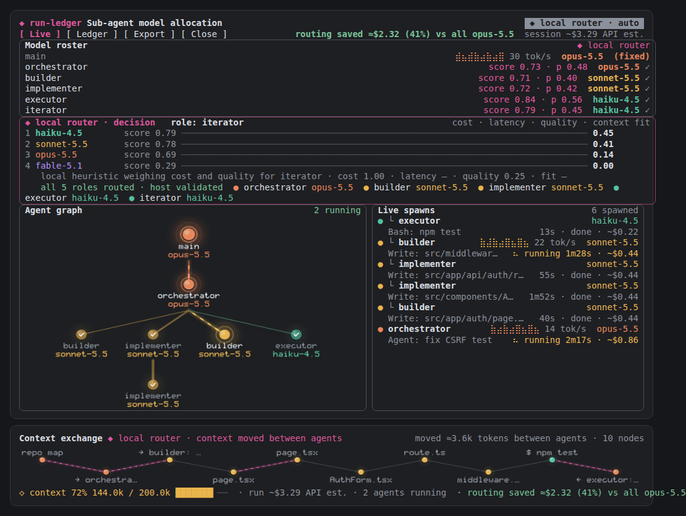
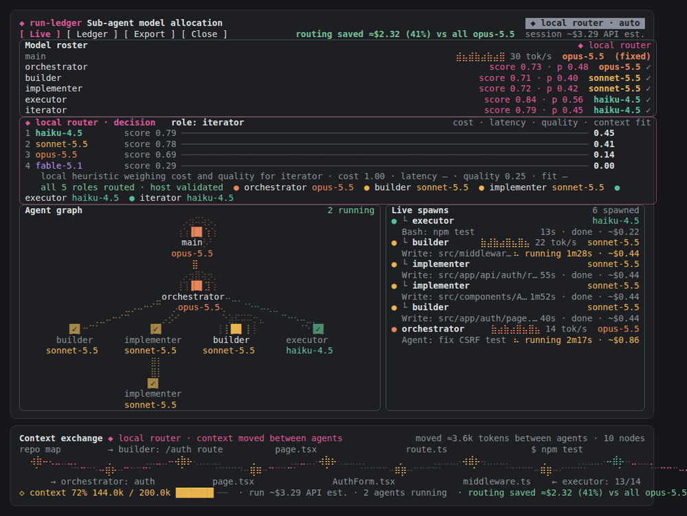
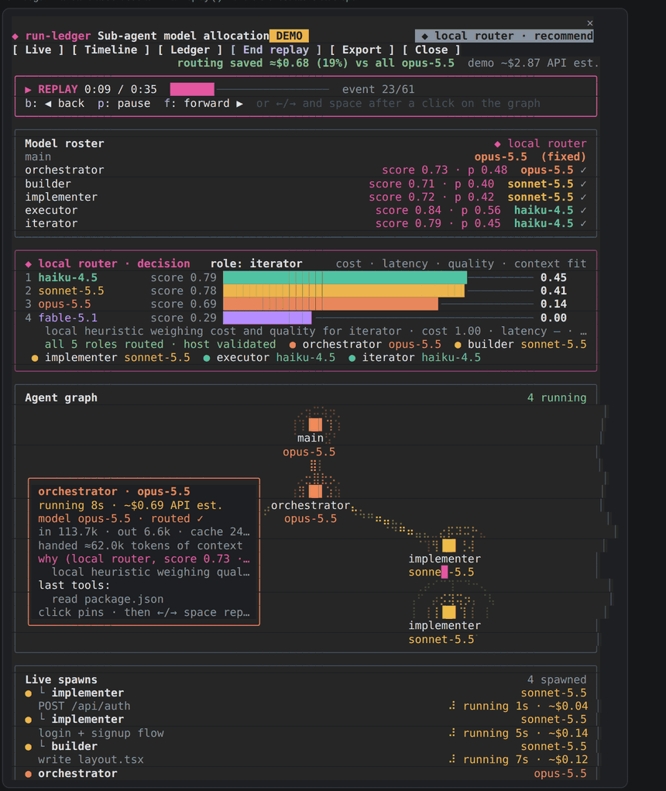
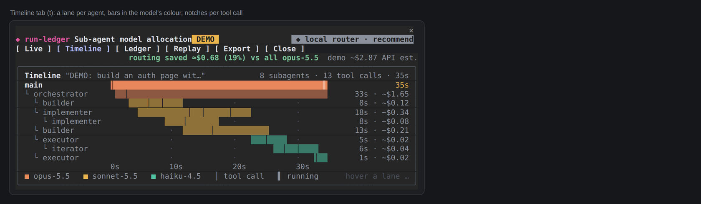

# run-ledger

A Claude Code mod (function-hooks plugin, built on 2.1.288, 0.5.1 tested on 2.1.303) that shows **sub-agent
model allocation** live: which model each subagent runs on and why, an animated agent graph, the context that
moves between agents, and what it all costs at API rates. `/run-ledger` opens it.

## 0.5.1: what changed over 0.5.0

0.5.1 is 0.5.0 with the fixes found running 0.1.x on a real terminal (Rex, a 108-column pane), carried over:

- **Safe upgrade over 0.1.x.** A session that ran 0.1.x keeps its ledger in `$.state` without `items` and
  `pulses`; a hot reload into 0.5.0 then failed in `agent.spawn` and `turn.complete` (`addItem`/`addPulse`).
  `session.start` now fills the missing fields and keeps the rest (`normalizeLedger`).
- **Local time.** Runs show the machine's clock (`12:29`), not UTC.
- **Background hand-backs.** A background subagent's report, handed back through the engine's internal
  `SubagentHandback` tool, becomes its result (`latest: handed back its report`) instead of `unknown`, and the
  main-loop turn it starts is labelled `↩ <role> "<description>" handed back its report` (source
  `agent:<id>`) instead of the raw `<agent-message …>` text. A subagent's own turns never become runs (nor
  roster rows) of their own. Labels drop markup tags.
- **The ledger beside `/cost`.** Some requests never pass a hook (engine calls outside the turn loop, for
  example the auto-mode classifier, compaction, titles). The Ledger tab reads the engine's own total
  (`$.session.usage().cost`, the figure `/cost` shows) and prints it beside the count:
  `Session: 9 req · ~$0.58 · /cost $0.94 (~$0.36 outside hooks)`. The ledger takes a baseline when it loads
  with nothing counted and at `/run-ledger reset`, so both figures cover the same span; the gap is left out
  while a counted request is unpriced, and in the demo.
- **Opening by itself, once.** The first-subagent open is now kept in state, so a hot reload does not open
  the pane again; it never opens over a pane already open, and never after you close the pane by hand (its
  close mark) in that session. `autoOpen: false` turns it off.
- **The receipt waits for background subagents.** 0.5.0 wrote a run's receipt when its main turn ended, while
  a background subagent still worked: its requests and the routing savings were missing (`routing cost
  +$0.000051 (0%)`, `1 still running in the background`). The receipt (and the sound) now waits until no
  subagent of the run is running, then comes once, with the run's duration up to its last subagent's end
  (live, 2026-10-19: `haiku-4.5 ~$0.03 · … · routing saved ≈$0.10 (26%) vs all opus-5.5`). A subagent the
  engine reports ended without a turn of its own (killed, stopped) settles its run on the next check.
- **Jev's own cost under a hundredth of a cent** shows with two significant figures (`$0.000048`), never as
  `$0.0000`.
- **Cards are never cut.** 0.5.0 drew a graph node's card beside the node whenever 24 columns were free there,
  as wide as that room: a node in the middle of the graph (27–33 columns free on each side in a 69-column
  graph) got a narrowed card whose lines ended in `…`, and every line was also cut at 42 characters before
  drawing. Now a card keeps its full lines, is word-wrapped to its full width (a path or URL longer than a row
  is split across rows), sits beside the node only where the whole card fits and over the picture otherwise.
  Where the box is too short, the hint goes first, then the last rows give way to `… +N more lines`. The same
  wrapping applies to the cards of Live spawns and the Timeline.

**Width.** The engine docks the pane beside the transcript only in the fullscreen layout from 110 columns;
under that (or on the main screen) it seats the pane inline above the prompt, held to a third of the screen
(measured on 2.1.303: 6, 11 and 18 body rows at 24, 40 and 60 rows), and this layout is tall. An open the mod
makes by itself is seated from 144 columns, or 110 once you have opened the pane yourself. Keep the Claude
pane at 110 columns or more. In Rex (`TERM_PROGRAM=rex`) and Tern (`TERM_PROGRAM=tern`) the graph is drawn in braille.

On Ghostty and kitty the graph and the band are **real pixels**: glowing nodes, smooth edges, packets that
move by the pixel.



On other terminals, and inside tmux, the same pictures are drawn in braille:



Point at a node for its card; replay the run with `r`, or step through it with ←/→. Recorded in a real
Claude Code terminal:



**Try it without spending a token:** `/run-ledger demo` plays a scripted run with sample data. It is marked
`DEMO`, makes no model calls, and nothing of it reaches the ledger, the status line or the routers' history.
`/run-ledger demo off` ends it.

## What you see

**The pane** (`/run-ledger`; it also opens on the session's first subagent):

- **Model roster**: `main` (fixed) and every role or subagent type, with the router's score, `p` (the
  winner's share) and the chosen model in its colour. `✓` marks a model that was applied. While Jev
  weighs a spawn, the row reads `Jev deciding ⠋`.
- **Decision card**: the latest decision. Candidates are ranked with a score bar and `p`, followed by the
  reason and the winner's criteria (cost, latency, quality, context fit). Once several roles are routed:
  `all N roles routed · host validated`.
- **Agent graph**: main → subagents → their subagents, as a tree. Each node is a solid block in its model's
  colour, with `✓` when done and `✗` when failed. In motion:
  - **halos** ripple out of running agents and beat faster as the agent writes faster (live tokens/s
    from the request stream);
  - **dashes flow** down the edges into running agents;
  - a **ripple** marks a new agent, and a green (or red) **burst** marks one that ended;
  - **packets with fading trails** travel down an edge when a subagent starts (pink: route) and back up
    when it ends (in its model's colour: result);
  - **edge width** follows the context the subagent was handed: 1 dot under 5k tokens, 2 under 50k,
    3 above.

  On Ghostty and kitty this is a picture (see [Pixels](#pixels-on-ghostty-and-kitty)). On other terminals
  it is a braille `Raster` repainted about 16 times a second with `$.ui.blit` while something moves. On
  desktop, VS Code and mobile it is an `Svg` animated with SMIL.
- **Live spawns**: newest first, nested ones marked `└`, with model, latest tool call, elapsed time,
  status and API-rate cost. A running agent shows a braille **sparkline of its output over the last 16 s**
  and its tokens/s; the roster's `main` row shows the same.
- **Header**: `routing saved ≈$0.84 (62%) vs all opus-5.5`. It takes the same tokens, priced as if every
  request had run on the baseline model (`baselineModel`), net of Jev's own cost. If the routing cost more
  than the baseline, it reads `routing cost +$…`. The session cost rolls to each new value like an odometer.
- **Decision card**: the bars race in from zero as each decision lands.
- **Ledger tab** (`g`): session totals, cost-by-model bars, runs to pick, and each run's requests with
  tokens and cost. **Export** (`e`) writes JSON and CSV.

**The Context exchange band**, above the prompt while Claude works (and for two minutes after):

- Pink links flow from producer to receiver, and a new piece lands with a ripple.
- A timeline of the run's context in two lanes: files read and written, commands run, tasks handed to
  subagents, results handed back. Each piece is coloured by the model of the loop that took it in.
- A dashed pink link joins a piece to the loop that produced it when another loop took it in (a file one
  agent wrote and another read, a task, a result).
- The header shows `moved ≈X tokens between agents · N nodes`. The bottom line shows context fill
  (`◇ context 72% 144.0k / 200.0k`), the run's cost, the number of agents running and the run's savings.

A dim transcript line per routing decision (`◆ router: executor → haiku-4.5 (score 0.84 · p 0.56)`) is on by
default (`logDecisions`).

The pane and the band make **no model calls**. `claude plugin validate` lists no `$.model.*` call in the
module.

## Cards, replay and the Timeline

**Cards.** Point at a node of the graph, a row of Live spawns or a lane of the Timeline and its card opens
beside it:

- status, elapsed time and API-rate cost;
- the model, whether it was routed (`routed ✓`), and the recommended model when it differs;
- tokens in, out and from cache, and requests;
- the context it was handed;
- the router's reason, with score and `p`;
- its last five tool calls, newest first, and its result.

A click on a node pins its card; a second click unpins it. On the graph, an invisible layer (a `Client`)
over the picture finds the node under the pointer. Rows and lanes use hover groups, so no hook runs while
the pointer moves.

**Replay.** `r` replays the run the pane shows from its first event, at 3× and skipping quiet stretches. The
roster, decision card, graph, spawns and Timeline show the run as it stood at that moment, cards included.

| Key | What it does |
| --- | --- |
| `r` | start or end the replay |
| `p` | play or pause |
| `b` / `f` | back or forward one event |
| ←/→, space, Home, End | the same, after a click on the graph |
| `l` | back to live |

`/run-ledger replay` opens the pane replaying the latest run. Replay only reads what the ledger already
holds; live tokens/s is not recorded, so sparklines are hidden while replaying.

**Timeline** (`t`, or `/run-ledger timeline`). One lane per loop: main, then each subagent under its parent.

- Each lane has a bar in its model's colour from start to end, dim once done, red if it failed.
- A notch marks each tool call, and `▌` marks a lane still running.
- On the right of each lane: its duration and cost.
- An axis in round steps runs underneath; during a replay, a pink line marks the replay's moment.



## Finish: themes, opening, receipt, sound

- **Themes** (`theme`, or `/run-ledger theme <name>`):
  - `neon`: the default, bright and glowing;
  - `minimal`: muted colours, little glow, one halo ring;
  - `contrast`: high contrast on black;
  - `light`: for a light terminal.

  With `auto`, run-ledger picks `light` when the terminal reports a light background through `COLORFGBG`,
  and `neon` otherwise. Not every terminal sets it; set the theme yourself if yours does not.
- **Opening** (`intro`). When the pane opens, nodes pop in level by level, edges grow out of their parent,
  and the roster cascades in. It lasts about a second.
- **Receipt** (`receipt`). When a run with subagents ends, a few dim lines go into the transcript; they are
  never sent to the model:
  - the run, its duration and outcome;
  - subagents and models, requests, retries, cache hit rate;
  - cost per model and the total, as an API estimate (not a subscription charge);
  - what routing saved.

  `always` writes a receipt for every run; `off` writes none; `/run-ledger receipt` writes the latest run's
  receipt again.
- **Sound** (`sound`, off by default, or `/run-ledger sound on`). A short chime when a run with subagents
  ends, and a lower one if something failed. macOS plays it with `afplay`; Linux and Windows terminals have
  no player, so they play nothing.

## Pixels on Ghostty and kitty

The graph and the band are drawn as pictures (an `Image`, shown with the kitty graphics protocol):

- **Nodes** are glossy spheres in their model's colour with a soft glow. A running agent's glow and halos
  beat with its output speed. A finished one dims, with a check or a cross.
- **Edges** leave the parent from under its name and model, so a line never crosses a label. Into a
  running agent, a glowing tube with light flowing down it.
- **Packets** move along the edge with a bright core, a glow and a fading trail.
- **Labels** use a built-in pixel font, smoothed with Scale2x and anti-aliased, one letter per terminal
  cell.

How it works:

- The mod draws each frame itself (an anti-aliased rasterizer) and encodes it as PNG in plain JavaScript,
  since the hooks environment has no zlib. Frames have a transparent background, so the terminal's own
  background shows through.
- While something moves, `$.ui.blit` swaps the picture: every 80 ms while a packet, ripple or burst is in
  flight, every 160 ms otherwise (halos only). A frame never comes sooner than three times what the last
  one took to make, so drawing stays under about a third of one core. A graph frame takes about 30 ms at
  density 2 and 10 ms at density 1 (measured on the build machine). Nothing moving, nothing is drawn.
- **Which terminals:** with `graphics` on `auto`, pixels are used when the environment says Ghostty or
  kitty (`TERM_PROGRAM`, `TERM`, `GHOSTTY_RESOURCES_DIR`, `KITTY_WINDOW_ID`), and not inside tmux or
  screen (`TMUX`, `STY`). These are the only variables read for it. A `TERM_PROGRAM` naming another
  program wins over the kitty clues: Tern sets `TERM=xterm-kitty` and `KITTY_WINDOW_ID` and answers the
  image probe, but draws no placeholder images, so pixels there left the graph blank.
- **Fallback:** if the terminal answers that it draws no images there, the mod switches to braille for
  the rest of the session and says so once.
- Pictures assume a 9:20 terminal cell, close to most monospace fonts. With another shape, circles stretch
  slightly.

```
/run-ledger graphics pixels    always try pixels (e.g. WezTerm)
/run-ledger graphics braille   always braille
/run-ledger graphics auto      back to detection
```

`pixelDensity` (default 2, for Retina screens) sets the pixels per point. 1 suits a standard screen and
costs about a third of the CPU.

## Video mode: roles + automatic routing

```
/run-ledger roles on        registers run-ledger:orchestrator, :builder, :implementer, :executor, :iterator
/run-ledger routing auto    applies the router's choice to eligible subagents
```

Other commands: `live`, `timeline`, `ledger`, `replay`, `demo [off]`, `receipt`, `export [folder]`, `reset`,
`graphics auto|pixels|braille`, `theme auto|neon|minimal|contrast|light`, `sound on|off`.

With roles on, the router lays out the whole roster at each prompt. With routing `auto`, each role's subagent
runs on its routed model. Auto routing applies only to registered roles and the types listed in
`autoRouteTypes`, never to a fork, never when the Agent call named a model itself, and only to a model this
host offers and prices. `/run-ledger roles off` and `/run-ledger routing recommend` undo it. Both commands
change the plugin's settings, which reloads it.

## The routers

**Local router** (default, while Jev is not connected): a transparent heuristic over four criteria, each
from 0 to 1:

| Criterion | From |
| --- | --- |
| cost | blended list price (¾ input, ¼ output); the cheapest is 1 |
| quality | capability order of the model lines (Haiku < Sonnet < Opus < Fable), nudged by this machine's success rate for the role once there is history |
| latency | median duration of past subagents per model on this machine; no data, not counted |
| context fit | context window against the context handed over (forks: none counted) |

Each role weighs them differently: orchestrator favours quality, executor and iterator favour cost and
latency, builder and implementer sit between. Built-in types borrow the closest role (`Plan` → orchestrator,
`Explore` → executor, others → implementer). The score is the weighted mean over the criteria with data.
`p` is the softmax share of the winner. Fresh, the roster comes out as orchestrator → opus-5.5,
builder/implementer → sonnet-5.5, executor/iterator → haiku-4.5. History in the mod's store shifts it.

**Jev**: with `jevEndpoint` set, every spawn asks Jev through your adapter (contract below), and Jev's
answer replaces the local router's. With it empty, no Jev call is made and no credential is read.

## How costs are counted

- **API-rate estimates, not subscription charges.** Prices are Anthropic first-party API list prices dated
  `2026-09-25` (`hooks/prices.ts`). A Claude subscription is not billed per token. Bedrock and Vertex price
  separately.
- **Each request is counted once**, in the `turn.step` hook, keyed by `loop | turn | step index | attempt`.
  The turn's summed usage (`turn.complete`) is never added on top.
- **A re-send of the same step** counts as its own request and as a *retry seen*. Retries the engine makes
  inside one request's stream are an opaque marker in this API, so they cannot be counted.
- **Unknown stays unknown.** No usage, or a model missing from the price table, gives a cost of `unknown`.
  Totals read like `~$0.42 + 2 unknown` and never count an unknown as $0.
- **Background subagents stay linked to their run**, even after that turn ends.
- **Plugin model calls** (`$.model.complete` / `$.model.fork` by another plugin) are attributed to that
  plugin and the running turn. A call made with an alias (`haiku`) is priced as its current model and marked
  `alias assumed`.
- **Context sizes and live speed are estimates**: tokens ≈ characters / 4, marked `≈`. Live tokens/s is
  measured from the streamed chunks and kept in memory only.
- **Savings are estimates**: the same tokens priced on the baseline. Another model might have used a
  different number of tokens. Requests with unknown tokens or price stay out of both sides.
- Known under-estimates: 1-hour cache writes cost 2× input, but 1.25× is used because usage does not say
  which TTL was written. Fast mode is billed at 2× and is not flagged in usage.

## Jev adapter contract

On every subagent spawn, run-ledger POSTs this (run-ledger's own contract; your adapter maps it onto Jev):

```json
{
  "schema": "run-ledger.jev-request/1",
  "task": { "prompt": "...(<=4000 chars)", "description": "...", "agentType": "run-ledger:builder",
            "requestedModel": null, "parentModel": "claude-opus-5-5" },
  "availableModels": [ { "id": "claude-haiku-4-5",
                         "usdPerMTok": { "input": 1, "output": 5, "cacheWrite": 1.25, "cacheRead": 0.1 },
                         "pricesAsOf": "2026-09-25" } ],
  "budget": { "limitUsd": null, "spentUsdEstimate": 0.42, "spentHasUnknown": false },
  "pastResults": [ { "agentType": "run-ledger:builder", "model": "claude-sonnet-5-5", "outcome": "completed",
                     "costUsd": 0.04, "durationMs": 40000, "at": 0 } ]
}
```

It expects the chosen model, the reason, and optionally the ranking the decision card draws:

```json
{ "model": "claude-haiku-4-5", "reason": "why", "confidence": 0.7,
  "ranking": [ { "model": "claude-haiku-4-5", "score": 0.86,
                 "criteria": { "cost": 1, "latency": 0.9, "quality": 0.4, "fit": 1 } } ],
  "cost": { "usd": 0.0004 } }
```

- `cost` is Jev's own cost: `{ "usd": n }` or `{ "model", "usage": { "input_tokens", "output_tokens" } }`.
  When it is absent, Jev's cost shows as `unknown`.
- A model outside `availableModels`, a non-200 answer, invalid JSON or no answer within `jevTimeoutMs` is
  recorded as an error, and the spawn keeps the engine's own choice.
- **Egress:** with Jev connected, the task prompt (up to 4000 characters) leaves the machine for your
  adapter.

## The JEV adapter (`adapter/jev-adapter.mjs`)

The adapter this contract asks for, for TypeSafe's JEV, ships with the mod. Each request becomes one JEV call:

- `POST https://api.typesafe.ai/v1/systemone`, `Authorization: Bearer $TYPESAFE_API_KEY`, model pinned to
  `jev-1.13.0` (an alias such as `jev-latest` moves when a release ships).
- `state`: the task (prompt redacted, see below), the offered models with their prices, the budget and the
  past results of that agent type. `questions.model`: one `choice` whose options are exactly the offered
  models, each described by tier and price; the task text is declared untrusted data.
- JEV's answer is refused, never repaired, unless the pinned model answered, the choice is an offered model,
  the probabilities cover offered models only, sum to 1 and peak at the choice. The answer run-ledger gets:
  the choice, a reason built from JEV's own numbers (`JEV jev-1.13.0 chose claude-haiku-4-5 (p 0.99) over
  claude-opus-5-5 (p 0.01)`), JEV's confidence, the ranking (each model's probability as its score; JEV gives
  no per-criterion figures, so those stay unknown) and JEV's own cost: input tokens × $0.042 per million,
  output free (docs.typesafe.ai/models, 2026-10-19). No usage reported: cost left out, shown `unknown`.
- Failures answer non-200, so the spawn keeps the engine's own choice: no key or JEV error → 503
  (`rate_limited` on 429), an answer that does not validate → 502, no answer within `--timeout-ms` → 504.
- **What leaves the machine:** the task prompt (at most 4000 characters, as run-ledger sends it) after
  credential-shaped strings are replaced with `[redacted]` (provider and GitHub keys, Slack tokens, AWS key
  ids, JWTs, bearer tokens, private keys, `NAME_KEY=value` lines), the description, the agent type, the
  model list, the budget and past outcomes. Nothing else. TypeSafe states Jev is not trained on requests.
- Listens on `127.0.0.1` only; a request with an `Origin` header (a web page) or a body that is not JSON is
  refused. `GET /health` answers without calling JEV. The log (one JSON line per request: agent type, choice,
  confidence, latency, input tokens, cost, or the problem) holds no task text and never the key.

Run it: `node adapter/jev-adapter.mjs --env-file <path to .env> [--port 8787] [--timeout-ms 3000]`
(`TYPESAFE_API_KEY` in the environment wins over the file), then set `jevEndpoint` to
`http://127.0.0.1:8787/recommend` (`claude plugin configure run-ledger@skills-dir --values-stdin`). Tests:
`node --test adapter/jev-adapter.test.mjs` (9 tests, a fake JEV, no network).

Measured on 2026-10-19 (live, jev-1.13.0): 0.4–0.8 s and about $0.00005 a decision. A file-reading Explore task
got `claude-haiku-4-5` (p 0.99); a 14-service billing redesign got `claude-opus-5-5` (p 0.77) over
`claude-sonnet-5-5` (p 0.22). With `routing: auto` and `autoRouteTypes: Explore`, the subagent ran on haiku and
finished its task (~$0.04 against ~$0.18 on opus for the same work).

## Settings (`/config`, or `pluginConfigs.run-ledger` in settings)

| Setting | Default | Meaning |
| --- | --- | --- |
| `roles` | `false` | Register the five routing roles (`/run-ledger roles on`). |
| `routing` | `recommend` | `auto` applies the routed model to eligible subagents (`/run-ledger routing auto`). |
| `autoRouteTypes` | `""` | Other subagent types auto mode may reroute, e.g. `Explore`. |
| `jevEndpoint` | `""` | Jev adapter URL. Empty: Jev off, the local router decides. |
| `jevModels` | current four | Model ids the routers choose from. |
| `budgetUsd` | `0` | Budget sent to Jev (API-rate estimate). 0: none. |
| `jevTimeoutMs` | `4000` | How long a spawn waits for Jev. |
| `band` | `auto` | Context exchange band: `auto` (while working + 2 min), `always`, `off`. |
| `logDecisions` | `true` | One dim transcript line per routing decision. |
| `autoOpen` | `true` | Open the pane when the session's first subagent starts: once a session, not over an open pane, not after you closed it by hand. |
| `baselineModel` | `claude-opus-5-5` | What "routing saved" compares against. |
| `graphics` | `auto` | `auto`: pixels on Ghostty and kitty (not in tmux), braille elsewhere. `pixels` or `braille` to force one. |
| `pixelDensity` | `2` | Pixels per point for the pictures, 1 to 3. Lower costs less CPU. |
| `theme` | `auto` | `neon`, `minimal`, `contrast`, `light`; `auto` follows `COLORFGBG`. |
| `receipt` | `subagents` | Receipt in the transcript when a run ends: `subagents`, `always`, `off`. |
| `sound` | `false` | Chime when a run with subagents ends (macOS). |
| `intro` | `true` | Opening animation when the pane opens. |

## State

Session data lives in `$.state`, so it survives hot reloads. Finished subagent outcomes (type, model,
outcome, cost, duration) are kept across sessions in the mod's `$.store` (last 200), and the routers use
them (latency, success rate, Jev's `pastResults`).

## Checks

```sh
claude plugin validate <mod folder>
claude plugin test <mod folder>   # 110 tests: pricing, dedup, retries, unknowns, attribution, routing, roles,
                                  # Jev, savings, canvas, graph motion, live rates, context exchange,
                                  # rendering, animation, export, PNG (checked by an inflater in the test),
                                  # pixel pictures, terminal detection, braille fallback, cards under the
                                  # pointer, replay (keys and buttons), Timeline, receipt, sound, themes,
                                  # opening, demo; and 0.5.1's: labels, hand-backs, local time, /cost beside
                                  # the count, opening once, a 0.1.x ledger in state
```

## Live test

0. **No tokens:** `/run-ledger demo`. The pane opens (nodes pop in), and a scripted run plays for 35 s:
   - point at a node, a spawn row, and (after `t`) a Timeline lane: each shows its card;
   - when it ends, the receipt appears in the transcript;
   - press `r` to watch it again, then click the graph and use ←/→;
   - `/run-ledger demo off` ends it.
1. Run `/run-ledger roles on`, then `/run-ledger routing auto`. The plugin reloads.
2. **Simple task:** send `say hi in five words`. The status line shows `ledger ~$… API est.`, the roster
   lays out five roles, and dim `◆ router:` lines appear.
3. **Subagent task:** send `use run-ledger:orchestrator to build a small hello page with a test`. Check:
   - the pane opens;
   - the graph grows main → orchestrator → builder/implementer/executor;
   - pink packets run down the edges as roles start, and back up as they finish;
   - halos pulse on running nodes, and `✓` marks finished ones;
   - Live spawns shows each role on its routed model, with elapsed time and cost;
   - the band fills with the files and results that moved, pink links where they crossed agents.
4. **Mod-triggered model call:** any plugin calling `$.model.complete` shows up as
   `plugin-model-call:<plugin>` in the Ledger tab.
5. **Each request counted once:** run `/run-ledger export` and check in the CSV that each `key` appears once.
6. **Routed model can run the task:** the spawn row ends `done` (not `✗ failed`) on its routed model, and
   the Ledger tab shows that model's requests.
7. **Hot reload:** edit any mod file. The pane redraws with the same runs.
8. **Pixels (Ghostty):** the graph shows glowing spheres and smooth lines, not braille dots. Run
   `/run-ledger graphics braille` to compare, then `/run-ledger graphics auto`. Inside tmux it stays
   braille.
9. **When the run ends:** with subagents, the receipt appears in the transcript. With
   `/run-ledger sound on` on macOS, a chime plays.

## Install

Copy the folder to `~/.claude/skills/run-ledger/`, or add its path to `CLAUDE_CODE_PLUGIN_DIRS` under `env`
in `~/.claude/settings.json`, or run once with `claude --plugin-dir <folder>`.
